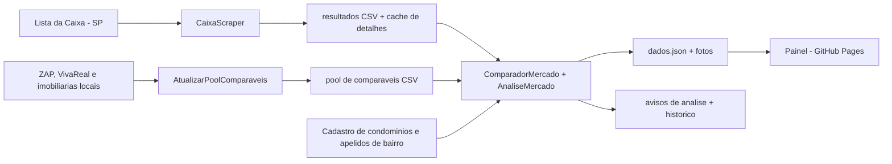

# Radar de Imóveis SP

Ferramenta em **Java 17** que coleta os imóveis à venda pela Caixa no estado de São Paulo, estima o valor de mercado de cada um com base em anúncios reais e calcula a margem de revenda. O resultado é publicado em um painel online para clientes e corretores.

> O código-fonte completo é mantido em repositório privado, porque contém cadastros e regras do meu negócio. Este repositório é a vitrine técnica do projeto: arquitetura, decisões e metodologia. Posso mostrar o código em entrevista.

**Painel online:** https://svalessandro.github.io/radar-imoveis-sp-site/

## O problema

Quem investe em imóveis da Caixa precisa saber, antes do leilão, se a compra deixa margem na revenda. Fazer isso à mão para centenas de imóveis, em várias cidades, é lento e inconsistente. O Radar automatiza a coleta e aplica a mesma regra de avaliação a todos os imóveis.

## Como funciona

1. **Coleta dos imóveis da Caixa:** navegador automatizado (Playwright) baixa a lista do estado e abre a página de detalhe só dos imóveis novos ou com preço alterado. O restante vem de cache gravado em lotes, e uma coleta interrompida continua de onde parou.
2. **Coleta dos comparáveis:** anúncios de portais e de dezenas de imobiliárias locais, por cidade, tipo de imóvel e rua, com leitores específicos por plataforma.
3. **Análise:** limpeza da base, estimativa do valor de mercado e cálculo da margem.
4. **Publicação:** geração do `dados.json` e das fotos que alimentam o painel, com uma trava que impede um imóvel de ir ao ar sem a análise completa.

## Metodologia de avaliação

- **Limpeza da base:** remove anúncios duplicados (entre coletas e entre fontes), revendas da própria Caixa, repasses e ágios (R$/m² abaixo de 35% da mediana da cidade) e valores atípicos (abaixo de 60% da mediana do grupo). Ignora anúncios de cidades vizinhas.
- **Valor de mercado:** mediana dos anúncios comparáveis, com desconto de 15% sobre o preço anunciado. O critério muda por tipo: condomínio, rua, bairro e faixa de área.
- **Confiabilidade:** "Confiável" com 5 ou mais anúncios, "Pouco confiável" com 3 ou 4. Com menos de 3, usa a avaliação da Caixa como referência e o imóvel fica fora das oportunidades.
- **Margem:** valor de mercado menos preço de compra menos custos (documentação, comissão de venda, comissão do leiloeiro e débitos de condomínio).
- **Histórico:** cada anúncio e cada imóvel da Caixa são registrados por data, para acompanhar reduções de preço.

## Decisões de engenharia

- **Cache incremental e retomada:** a coleta leva horas, então tudo é gravado em lotes e pode ser retomado sem refazer o que já foi feito.
- **Trava de publicação:** o painel é público, então só entra o que passou pela análise completa.
- **Fontes isoladas por classe:** cada plataforma de imobiliária tem seu leitor (`Fonte*`), o que permite incluir uma cidade nova sem mexer no núcleo.
- **Cadastros manuais com prioridade:** o nome do condomínio vem do título da página da Caixa e pode ser corrigido por um cadastro manual.
- **Testes automatizados (JUnit 5):** cobrem a leitura da lista da Caixa, a normalização de endereços, o cadastro de condomínios, os filtros da base e as regras de avaliação.

## Stack

Java 17 · Maven · Playwright for Java · OpenCSV · JUnit 5 · HTML/JavaScript (painel) · GitHub Pages · PowerShell (rotina de atualização)

## Escala

O painel acompanha mais de 3.000 imóveis à venda no estado de São Paulo (dados de 11/11/2026). O projeto começou como piloto em Bauru, Ribeirão Preto, São José do Rio Preto, Piracicaba e Araraquara.

## Contato

Alessandro Aparecido da Silva · Bauru/SP · [LinkedIn](https://www.linkedin.com/in/alessandroasv/) · [GitHub](https://github.com/svalessandro)
